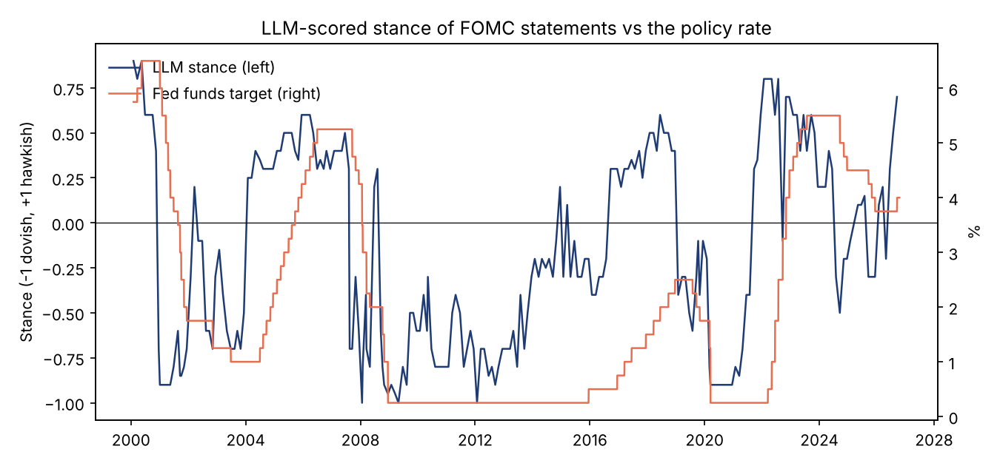

# fomc-signal-agent

An LLM pipeline that reads every FOMC statement since 2000, scores how hawkish or dovish it is, and tests whether those scores carry information for rates and FX.

The questions it answers:

1. **Can an LLM label Fed language as well as a fine-tuned model?** Sentence-level labels are checked against 476 human-labelled FOMC sentences and compared with a dictionary, a TF-IDF classifier and FOMC-RoBERTa.
2. **Do tone surprises move markets?** On statement days, does the change in tone explain the move in the 2-year yield and the dollar beyond the rate decision itself, in sample and out of sample?
3. **Is there anything left to trade?** Does the 2-year yield keep drifting in the direction of the tone surprise over the following week?

## Pipeline

```
federalreserve.gov ──> fed.py        226 statements (2000-2026, incl. unscheduled meetings), cached HTML
                         │
                         ├──> scoring.py   LLM document assessment + sentence labels
                         │      llm.py     Anthropic / OpenAI / Claude Code backends, JSON schema,
                         │                 on-disk cache, token and cost log
                         ├──> baselines.py dictionary, TF-IDF + logistic regression, FOMC-RoBERTa
                         │
FRED ─────────────────> events.py    2y/10y yields, trade-weighted dollar, policy target
                                     -> statement-day regressions, OOS test, drift trade
```

**Document assessment.** One call per statement returns a stance in [-1, 1], the policy action, the direction of forward guidance, inflation and growth concern scores and up to four quotes that justify the score. The schema is enforced (a forced tool call for Anthropic, `json_schema` for OpenAI, validation plus retry for the CLI backend). Quotes are then checked against the statement text, and if the model paraphrased or invented one it gets the offending quotes back and has to try again. Each statement is scored three times to measure how stable the score is.

**Sentence labels.** Every policy sentence (the voting record is dropped) is labelled hawkish, dovish or neutral in one batched call, using the annotation definitions from Trillion Dollar Words (Shah, Paturi and Chava, ACL 2023). Net tone is `(hawkish - dovish) / sentences`. Because this works at the sentence level, the same prompt can be validated directly against the human labels.

**Event study.** Statements are released at 2pm ET, so the close-to-close change on the release day captures the reaction. A tone surprise is the change in a measure from the previous statement, standardised. Each regression controls for the change in the fed funds target, so the tone has to explain something beyond the decision. HAC standard errors throughout. The out-of-sample test refits on an expanding window and compares forecast errors with a decision-only model.

**Reproducibility.** Every LLM call is cached under a hash of provider, model, prompt version and input, together with token counts, so re-running is free and any score can be traced to the exact prompt and model that produced it.

## Run it

```bash
git clone https://github.com/YDawoud7/fomc-signal-agent
cd fomc-signal-agent
python -m venv .venv && source .venv/bin/activate
pip install -e ".[dev]"
pytest -q

export ANTHROPIC_API_KEY=...              # or use --provider claude-code / openai
fomc-signal all --provider anthropic      # fetch, validate, score, analyze
```

Optional fine-tuned transformer baseline: `pip install -e ".[roberta]"` and add `--roberta`.

Outputs go to `results/` (tables in Markdown and JSON, the event panel as CSV) and `figures/`.

## Results

All numbers below come from `fomc-signal all --provider claude-code --model haiku` (full tables in [`results/`](results/)).

### 1. Labelling quality (476 human-labelled FOMC sentences)

| Classifier | Accuracy | Macro F1 |
| --- | ---: | ---: |
| Dictionary | 0.532 | 0.439 |
| TF-IDF logistic regression (trained on 1,903 labelled sentences) | 0.586 | 0.566 |
| LLM, Claude Haiku, zero-shot | **0.681** | **0.665** |
| LLM, Claude Sonnet, zero-shot | 0.651 | 0.635 |

With no training data, the LLM beats a classifier trained on four times as many labelled sentences. The smaller model did better than the larger one. Sonnet labelled more hawkish sentences as neutral, so the bigger model isn't automatically the better labeller. The fine-tuned FOMC-RoBERTa baseline is wired in (`--roberta`) but wasn't part of this run.

### 2. The stance tracks, and leads, policy



The document stance turns dovish before the 2001, 2007 and 2019 easing cycles and hawkish ahead of the 2004, 2015 and 2022 hiking cycles. Scoring is stable: across repeated runs the stance moves by 0.06 on average (on a -1 to 1 scale), and every supporting quote was verified as a verbatim extract from its statement.

### 3. Do tone surprises move markets? A little, and mostly in recent years

Statement-day change in the 2-year yield, controlling for the rate decision (HAC t-stats, 226 statements, 2000-2026):

| Tone surprise | bp per 1 s.d. | t-stat | Out-of-sample R² gain |
| --- | ---: | ---: | ---: |
| LLM document stance | 1.17 | 1.76 | +0.008 |
| TF-IDF net tone | 0.99 | 1.65 | +0.005 |
| Dictionary net tone | 0.84 | 1.22 | +0.001 |
| LLM sentence net tone | 0.42 | 0.82 | -0.005 |

* **The sign is right everywhere but the effect is small.** A one standard deviation hawkish surprise moves the 2-year yield by about 1bp on the day. Statements are only one part of FOMC day: the decision itself, the dot plot and the press conference carry much of the news.
* **It's a post-2013 phenomenon.** From 2013 the LLM stance effect rises to 1.7bp (t = 2.5) and explains 9% of statement-day moves. That fits the move to forward guidance, when the wording of the statement *became* the policy signal. Before 2013 nothing is significant.
* **The 10-year reacts more cleanly** (1.1bp, t = 2.4, with an out-of-sample R² gain of 1.7%), consistent with guidance mattering most for the path of rates further out.
* **The dollar doesn't respond** at daily frequency for any measure.
* **There's nothing left to trade a week later.** Trading the 2-year in the direction of the surprise over the next five days earns roughly zero for every measure, so whatever information there is gets priced on the day.

**Honest bottom line:** the LLM is clearly the best *labeller*. As a trading signal, its stance is the strongest of the four but still marginal on daily closes. The obvious next steps are intraday data (a 30-minute window around 2pm would strip out the rest of the day's noise), adding press conference transcripts, and measuring surprises against market expectations rather than the previous statement.

## Tests

26 tests, including HTML fixtures for each generation of the Fed's website, schema validation and retry logic, the quote check, the event-window alignment (weekends roll forward), recovery of a known effect from synthetic data and an end-to-end run of the CLI with a stand-in model.

## Data and licences

* FOMC statements: federalreserve.gov (public domain).
* Market data: FRED series `DGS2`, `DGS10`, `DTWEXBGS`, `DTWEXM`, `DFEDTAR`, `DFEDTARU`.
* Labelled sentences: [Trillion Dollar Words](https://github.com/gtfintechlab/fomc-hawkish-dovish) (CC BY-NC 4.0), downloaded at run time and not redistributed.

## References

Shah, A., Paturi, S. and Chava, S. (2023). Trillion Dollar Words: A New Financial Dataset, Task & Market Analysis. *ACL 2023*.
